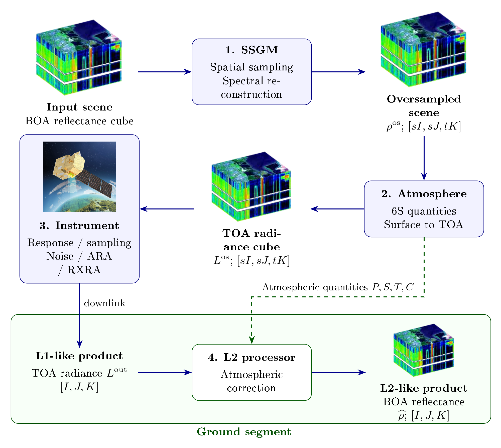

# CHIME parametric performance model

This repo hosts a lightweight, shareable model of the instrument performance of **CHIME**, the Copernicus
Hyperspectral Imaging Mission for the Environment. It is a reference implementation of the
SPIE paper [*"CHIME System Performance at Critical Design Review: A parametric model for
end-to-end simulation analysis"*](https://spie.org/spie-sensors-imaging/presentation/CHIME-system-performance-at-critical-design-review--a-parametric/14279-7)
(Fernandez Nunez et al., ESA-ESTEC / OHB System AG / ESA-ESRIN).

This software is developed and maintained by the **CHIME Project** at the European Space Agency (ESA).

The model aims to support Sentinel User Preparation studies and similar initiatives that require knowledge of 
the CHIME performance beyond the system requirements and need to generate its own datasets

The model inputs oversampled TOA radiance and outpus CHIME like L1 data. As such it can be integrated in third party simulators that generate oversampled TOA radiance or be used within the proposed mini E2E reference implementation

It is **not** a replacement for dedicated E2E simulators like CHIME OPSI or CHEES
nor industrial verification tools, nor a rigorous per-pixel uncertainty propagation (CHIME ships that separately),
and not an orbit or direct-location framework. 


## Status

The package provides the radiometric, spectral and spatial performance functions,
CDR-2025 parameters and a mini E2E pipeline covering scene generation,
atmospheric propagation, instrument acquisition and atmospheric correction.

Roadmap:
- Oct/Nov 2026 First release
- Nov 2026 Iterations as part of SUP workshop in ESRIN
- Dec 2027 v1.0 including full e2e first implementation
- Updates and maintenance throughout Phase D
- End of 2028 Update of Instrument modelling after Instrument level TVAC Characterisation 

## Download and install

Download a source archive from the [GitHub releases](https://github.com/esa/chime-performance-sup/releases),
extract it and open a terminal in that directory. Install it locally:

```bash
python -m venv .venv
source .venv/bin/activate
python -m pip install ".[pipeline]"
```

On Windows, activate with `.venv\Scripts\activate` instead. The release also provides
a universal Python wheel for local installation; it is the same file for all platforms.
The project is distributed through GitHub releases.

The `pipeline` extra installs EOPL (0.2.1 or later), Numba and Py6S for the mini E2E.
Use `python -m pip install .` if you only need the parametric model.
Py6S also requires a separately installed **6S executable**; see its
[installation guide](https://py6s.readthedocs.io/en/latest/installation.html).
For the AVIRIS-NG download examples, also install:

```bash
python -m pip install earthaccess
```

For development and tests, use `python -m pip install -e ".[dev,pipeline]"` followed by
`python -m pytest`. Set `SIXS_PATH` to include direct 6S comparisons.
To build the source archive and wheel yourself:

```bash
python -m pip install build
python -m build
```

The release workflow builds both files and tests the installed package on Linux,
Windows, Intel Mac and Apple Silicon with Python 3.12. The separate unit-test workflow
checks Python 3.10–3.12 on Linux. Publishing a GitHub release
tagged `v0.1.0` attaches the files once those checks pass. No registry publishing is configured.

## Use
The parameter files are included in `chime_perf/data/` and loaded with `ChimeParams.load()`.
`chime_excluded_regions.csv` supplies wavelength intervals for compliance-plot
annotations only. Its boundaries are estimates derived from low reference radiance,
not exact mission exclusion limits. The processing equations still evaluate those channels.
Use `ChimeParams.load(data_dir="path/to/parameters")` to supply a different parameter set.

Run `example/example.ipynb` for further details. A Jupyter environment is needed to
open the notebook interactively.

## Processing modules



AVIRIS cube illustration: [NASA/JPL](https://aviris.jpl.nasa.gov/data/image_cube.html).
CHIME artist's impression: © Thales Alenia Space, via [ESA](https://www.esa.int/ESA_Multimedia/Images/2020/11/CHIME).

- [SSGM](chime_perf/ssgm.py): spatial interpolation and spectral interpolation or library fitting.
- [Atmosphere](chime_perf/athmo.py): surface-to-TOA propagation using 6S quantities.
- [Instrument](chime_perf/instrument.py): spectral/spatial response, detector sampling and radiometric errors.
- [Reconstruction](chime_perf/reconstruction.py): atmospheric correction using the saved coefficients.

Each module schedules its mathematical operations through EOPL; implementations
are in [chime_perf/algorithms](chime_perf/algorithms). Select `--all` or one module:
`--ssgm`, `--athmo`, `--instrument`, `--reconstruction`.

### AVIRIS-NG examples

The two examples use real surface reflectance: snow at Senator Beck Basin from
[SnowEx21](https://doi.org/10.5067/ZAI3M64WWN5V), and agricultural fields near
Wellington from the [BioSCape AVIRIS-NG mosaic](https://doi.org/10.3334/ORNLDAAC/2427).
After installation, run these commands from the checkout:

Snow: 608 ACT × 779 ALT × 425 bands at 4 m, producing 81 × 104 × 250 samples:

```bash
python example/prepare_aviris.py snow --sixs-path /path/to/sixs

chime-sup --all \
  --input ../datasets/aviris_ng/snow.nc \
  --atmosphere ../datasets/aviris_ng/snow_atmosphere.nc \
  --config example/snow_config.yml \
  --output outputs/snow --save-intermediates
```

Fields: 512 ACT × 640 ALT × 425 bands at 5 m, producing 86 × 107 × 250 samples:

```bash
python example/prepare_aviris.py fields --sixs-path /path/to/sixs

chime-sup --all \
  --input ../datasets/aviris_ng/fields.nc \
  --atmosphere ../datasets/aviris_ng/fields_atmosphere.nc \
  --config example/fields_config.yml \
  --output outputs/fields --save-intermediates
```

Preparation reuses existing downloads and stores raw data, NetCDF inputs and 6S
coefficients outside Git in `../datasets/aviris_ng` (`--data-dir` overrides this).
Snow requires Earthdata login; fields are public. The YAML atmosphere settings are
illustrative assumptions; rerun preparation after changing them. All 425 wavelengths
are retained; negative/nonfinite source values become NaN, leaving gaps in plots.

With `--save-intermediates`, each module saves its product for the next one to load:
`ssgm/scene.nc`, `athmo/toa.nc`, `instrument/instrument.nc` and
`reconstruction/reconstructed.nc`. Each directory also contains a manifest and report.
Omit the flag for in-memory handoff; `athmo/toa.nc` still archives the atmosphere.
Standalone modules save directly in `--output`.

### Input and configuration

Input is a NetCDF cube named `reflectance`, with dimensions `ACT`, `ALT`, `SPE`,
coordinate units `m`, `m`, `nm` and reflectance units `1`.
The `geometry` attribute distinguishes map and sensor grids.
Settings are shown in [snow_config.yml](example/snow_config.yml) and
[fields_config.yml](example/fields_config.yml), including:

```yaml
scene:
  spatial_interpolation: true
  detector_spacing_m: 30.0
  spatial_oversampling: auto  # Or an integer: 5 gives a 6 m grid.
```

`auto` chooses the nearest integer detector-to-input spacing ratio on each spatial
axis (ties round up), anchored at the first input centre. Thus 4 m becomes 3.75 m,
5 m stays 5 m, and 5.5 m becomes 6 m. With interpolation disabled, the input must
already have regular integer oversampling.

- `scene.spectral_step_nm` sets spectral sampling; omit it to retain input wavelengths.
  `--library path/to/library.nc` selects NNLS spectral reconstruction instead of interpolation.
- `boundaries` uses edge repetition in space and wavelength, with 3-sigma kernel support.
  Genuine missing samples remain NaN; only channels centred within the input range are simulated.
- `instrument` controls noise, ARA, RXRA and spectral shifts; a fixed `seed` makes draws reproducible.
- `report` controls report sections and format (`py` or `ipynb`); the examples show input and final output.
  Set `breakpoints: true` to save intermediate operations, and `run_options.precision` to choose precision.

The 6S adapter samples atmospheric quantities at 2.5 nm and interpolates them to
the scene wavelengths. `--atmosphere` reuses saved quantities or accepts compatible
coefficients from another solver. Reconstruction reuses the original propagation
coefficients, averages them over each nominal channel response and applies the
inverse equations; this band approximation is not an exact spectral inversion.

## Citation and license

Please cite Fernandez Nunez et al., *CHIME System Performance at Critical Design Review:
A parametric model for end-to-end simulation analysis*, SPIE Sensors + Imaging,
[presentation 14279-7](https://spie.org/spie-sensors-imaging/presentation/CHIME-system-performance-at-critical-design-review--a-parametric/14279-7),
and state the software version used. The manuscript is included in `docs/`.

[CITATION.cff](CITATION.cff) contains the paper title, full author list and SPIE link.
The software is licensed under [Apache-2.0](LICENSE), all rights to the CHIME Project at European Space Agency.
